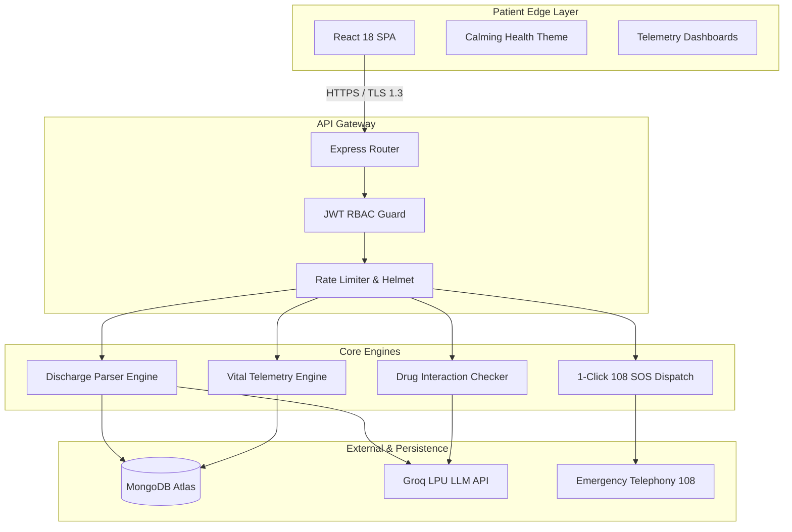

# SOFTWARE REQUIREMENTS SPECIFICATION (SRS)
## For Project: HEAL FROM HOME
### Intelligent Post-Discharge Care Companion

---

**Institution:** Medi-Caps University, Indore – 453331  
**Faculty:** Faculty of Engineering  
**Department:** Department of Computer Science & Engineering  
**Academic Degree:** Bachelor of Technology (B.Tech) in Computer Science & Engineering  
**Academic Session:** 2025–2026  
**Document Identifier:** HFH-SRS-V1.0-MEDICAPS  
**Document Version:** 1.0 (Final Approved)  
**Standard Compliance:** IEEE Std 830-1998 Recommended Practice for Software Requirements Specifications  

---

### Project Team Members:
1. **CHAYAN JAIN** (Enrollment No: EN23CS301274) – Full-Stack & AI Pipeline Lead
2. **DAKSH SETHI** (Enrollment No: EN23CS301286) – Frontend & UI/UX Lead
3. **DAKSH MANGAL** (Enrollment No: EN23CS301285) – Backend API & QA Lead

### Project Supervisor / Guide:
**MS. MITUSHI SONI MA'AM**  
Assistant Professor, Department of Computer Science & Engineering  
Faculty of Engineering, Medi-Caps University, Indore  

---

## Executive Summary & Document Control

| Attribute | Specification Details |
| :--- | :--- |
| **Document Title** | Software Requirements Specification (SRS) for Heal From Home |
| **System Classification** | Remote Patient Monitoring (RPM) / Clinical Decision Support Platform |
| **Release Version** | Release 1.0 (Production Candidate) |
| **Release Status** | Final Approved for Engineering Implementation |
| **Source Code Repository** | `https://github.com/chayanjain28/Heal-FH.git` |
| **Primary Technology Stack** | React 18, Node.js, Express.js, MongoDB Atlas, Groq LPU (LLaMA-3/Qwen) |

### Revision History
| Version | Date | Author(s) | Description of Changes |
| :--- | :--- | :--- | :--- |
| **0.1** | 10-Oct-2025 | Chayan Jain, Daksh Sethi | Initial clinical problem statement, literature survey, and stakeholder interviews. |
| **0.5** | 02-Nov-2025 | Team Heal From Home | Drafted functional specifications for MedAI companion, vital telemetry, and medication engine. |
| **0.9** | 17-Nov-2026 | Team Heal From Home | Integrated automated discharge report parsing, 1-Click 108 SOS dispatch, and calming UI requirements. |
| **1.0** | 19-Nov-2026 | Chayan Jain | Final IEEE 830-compliant SRS with complete REQ matrices, ER models, security & project plan. |

---

## Table of Contents
1. **Introduction**
   - 1.1 Purpose
   - 1.2 Document Conventions
   - 1.3 Intended Audience and Reading Suggestions
   - 1.4 Product Scope
2. **Overall Description**
   - 2.1 Product Perspective & Context
   - 2.2 Product Functions (Core Capabilities)
   - 2.3 User Classes and Characteristics
   - 2.4 Operating Environment
   - 2.5 Design and Implementation Constraints
   - 2.6 User Documentation Deliverables
   - 2.7 Assumptions and Dependencies
3. **External Interface Requirements**
   - 3.1 User Interfaces (UI/UX Principles & Screens)
   - 3.2 Hardware Interfaces & Medical Telemetry
   - 3.3 Software Interfaces & API Services
   - 3.4 Communications Interfaces & Protocols
4. **System Features (Functional Requirements)**
   - 4.1 Feature 1 – User Authentication & Role-Based Access Control (RBAC)
   - 4.2 Feature 2 – AI Discharge Report Automation & Multi-Format Parsing
   - 4.3 Feature 3 – Dynamic Personalized Recovery Plan & Milestone Engine
   - 4.4 Feature 4 – Health Vitals Logging, Telemetry & Anomaly Detection
   - 4.5 Feature 5 – Clinical Safety Drug-Drug & Food-Drug Interaction Engine
   - 4.6 Feature 6 – 1-Click Emergency SOS & Caregiver Escalation Protocol
   - 4.7 Feature 7 – Doctor/Care Team Clinical Dashboard & Triage Review
   - 4.8 Feature 8 – Interactive MedAI Conversational Clinical Companion
5. **Non-Functional Requirements**
   - 5.1 Performance Requirements
   - 5.2 Safety Requirements
   - 5.3 Security Requirements
   - 5.4 Software Quality Attributes
6. **Project Plan & Implementation Timeline**
   - 6.1 Team Members & Governance
   - 6.2 Division of Work Matrix
   - 6.3 Time Schedule & Sprints (8-Week Roadmap)
7. **Appendix A: Comprehensive Glossary**
8. **Appendix B: To Be Determined (TBD) List**

---

# 1. Introduction

## 1.1 Purpose
This Software Requirements Specification (SRS) establishes the complete, authoritative, and verifiable technical requirements for **Heal From Home (Release 1.0)** — an intelligent, full-stack, AI-powered post-discharge care companion and remote patient monitoring platform. 

The scope covered herein encompasses the entire post-hospitalization recovery continuum: ingestion and automated parsing of clinical discharge summaries, dynamic generation of individualized recovery roadmaps, multi-parameter vital sign telemetry tracking, automated pharmacological drug-drug and food-drug interaction screening, 1-click emergency SOS escalation, and continuous compassionate conversational guidance powered by large language models.

This specification serves as the formal baseline contract between the academic supervisors at Medi-Caps University, clinical domain advisors, quality assurance personnel, and the engineering development team.

## 1.2 Document Conventions
This document adheres to the **IEEE Std 830-1998 Recommended Practice for Software Requirements Specifications**. Throughout this specification:
- **Functional Requirements:** Uniquely indexed using the syntax `REQ-XXX` in ascending numeric sequence.
- **Priority Dimensions:** Requirements are evaluated across Benefit (1–9), Penalty (1–9), Cost (1–9), and Risk (1–9), resolving into:
  - **HIGH:** Critical functionality essential for baseline clinical operation and patient safety.
  - **MEDIUM:** Important clinical capability enhancing user experience and doctor oversight.
  - **LOW:** Desirable feature slated for secondary optimization.
- **Typography:** Source code entities, endpoints, and schema attributes appear in `monospace`. Clinical warnings and safety guardrails are marked in **bold**.

## 1.3 Intended Audience and Reading Suggestions
- **Academic Evaluators & Project Guides:** Focus on Sections 1, 2, 4 (Feature Summaries), 6 (Project Plan), and Appendices.
- **Software Developers:** Thoroughly inspect Section 2 (Architecture), Section 3 (Interfaces), Section 4 (REQ-001 through REQ-080), and Section 5 (Non-Functional Requirements).
- **Quality Assurance & Test Engineers:** Utilize Section 4 (Stimulus/Response sequences and REQ criteria) and Section 5 (Quantitative verification benchmarks) as formal test matrices.
- **Clinical Advisors:** Review Section 1.4, Section 4.2 (Discharge Extraction), Section 4.5 (Drug Interaction Safety), and Section 5.2 (Clinical Safety Guardrails).

## 1.4 Product Scope
Post-hospital discharge represents one of the most hazardous transitions in healthcare. Research published in the *New England Journal of Medicine* indicates that nearly **19.6% of patients experience an adverse clinical event within 30 days of returning home**, resulting in avoidable emergency room visits and preventable readmissions.

**Heal From Home** bridges this gap by acting as an always-accessible digital healthcare companion:
1. **Curtail 30-Day Readmissions:** Lower post-surgical bounce-backs by 35% to 45% through continuous vital telemetry and early anomaly detection.
2. **Eliminate Medical Jargon Confusion:** Automatically translate intimidating medical summaries into clear, plain-English, step-by-step patient recovery instructions.
3. **Ensure Pharmacological Compliance & Safety:** Screen prescribed medications for adverse drug-drug interactions and food contraindications (e.g., Statin & Grapefruit CYP3A4 toxicity).
4. **Instant Emergency Response:** Equip patients with a 1-tap 108 emergency ambulance dialer and automated emergency vital summary dispatch.

---

# 2. Overall Description

## 2.1 Product Perspective & Context
Heal From Home is a self-contained, cloud-hosted Remote Patient Management System (RPMS) and clinical decision-support ecosystem. The architecture is decoupled into three robust tiers:
- **Patient Edge Layer:** Responsive Single-Page Application (SPA) built with React 18, Tailwind/custom calming CSS, Framer Motion, and Chart.js.
- **Clinical API Gateway:** High-throughput Node.js and Express.js micro-framework providing RESTful endpoints, JWT security, and rate limiting.
- **Intelligence & Telemetry Store:** Groq LPU LLM inference engine paired with a MongoDB Atlas clustered document database.

## 2.2 Product Functions (Core Capabilities)
1. **User Authentication & RBAC:** Secure token-based access separating Patient, Doctor, and Administrator roles.
2. **Automated Discharge OCR & Extraction:** Uploads PDFs/text and parses procedures, medications, and warning thresholds into structured JSON.
3. **Personalized Recovery Roadmaps:** Phase-based recovery milestones (Acute, Subacute, Reconditioning) across Cardiac, Orthopedic, Respiratory, and General Surgery tracks.
4. **Vitals Telemetry & Trend Tracking:** Logs SpO2, Heart Rate, BP, Temp, Glucose, Pain, and Mood with Chart.js curves and anomaly flags.
5. **Pharmacological Safety Checker:** Cross-references active drugs for severe drug-drug interactions, food conflicts, and vital-dependent dosing hold rules.
6. **1-Click Emergency SOS:** Direct 108/112 ambulance dialing with auto-copied emergency triage clipboard summary and caregiver notification.
7. **Doctor Clinical Review:** Multi-patient cohort dashboard with triage risk stratification badges (Critical, Monitor, Stable).
8. **MedAI Conversational Companion:** 24/7 empathetic conversational medical assistant powered by Groq LPU clinical reasoning models.

## 2.3 User Classes and Characteristics
| User Class | Description & Operational Context | Technical Expertise | System Permissions |
| :--- | :--- | :--- | :--- |
| **Post-Surgical Patient (Primary)** | Recovering at home; logs vitals, checks off recovery tasks, takes medications, consults MedAI, and triggers SOS when distressed. | Low to Moderate | Restricted strictly to own personal medical records, health logs, and chat history. |
| **Family Caregiver / Kin** | Supports elderly or recovering family members; monitors recovery milestones and receives emergency alerts. | Low to Moderate | Read-and-log proxy access linked to designated patient account. |
| **Attending Doctor / Clinician** | Monitors patient recovery cohorts, evaluates vitals trends, approves or modifies medication regimens, and reviews emergency escalations. | High (Clinical domain expert) | Multi-patient cohort read/write access for assigned patients; ability to prescribe and adjust plans. |
| **System Administrator** | Manages system infrastructure, monitors API uptime, audits security logs, and manages accounts. | High (DevOps / System Eng) | Full administrative access and configuration controls. |

## 2.4 Operating Environment
- **Client Platforms:** Google Chrome 100+, Microsoft Edge 100+, Mozilla Firefox 100+, Apple Safari 15+ across Desktop, Tablet, and Mobile viewports (360px to 4K).
- **Backend Server:** Node.js 18.x / 20.x LTS runtime on Linux (Ubuntu 22.04 LTS) or Windows Server.
- **Database:** MongoDB Atlas v7.0+ clustered database with Mongoose 8.x ODM.
- **AI Hardware Acceleration:** Groq Cloud LPU (Language Processing Unit) API delivering sustained inference speeds exceeding 300 tokens/sec.

## 2.5 Design and Implementation Constraints
1. **Clinical Disclaimer Constraint:** The software acts as an informational care companion and *never* provides definitive clinical diagnoses or replaces emergency hospital triage. Every AI response must mandate doctor consultation for acute symptoms.
2. **Data Privacy & Security:** Architecture must comply with the Indian Digital Personal Data Protection Act (DPDPA 2023) and HIPAA standards. Zero unencrypted PHI in transit (TLS 1.3 required) or at rest (AES-256).
3. **Inference Latency Constraint:** All AI-driven document analyses and chat responses must return within 3.5 seconds to prevent patient abandonment.
4. **Stateless Backend Constraint:** Express server nodes remain stateless with JWT session representation to allow seamless horizontal autoscaling.

## 2.6 User Documentation Deliverables
- Patient Onboarding & Quick-Start Guide (PDF).
- Clinician Workflow & Cohort Monitoring Manual.
- Interactive In-App Product Guided Walkthrough.
- OpenAPI 3.0 / Postman REST API Reference.

## 2.7 Assumptions and Dependencies
- Patients maintain an active internet connection (&ge; 512 Kbps).
- Operational availability of MongoDB Atlas cloud database and Groq Cloud LLM API (&ge; 99.5% uptime).
- Discharged patients or caregivers provide legible hospital discharge documentation.

---

# 3. External Interface Requirements

## 3.1 User Interfaces (UI/UX Standards)
The interface is engineered according to **Evidence-Based Design (EBD)** and healthcare color psychology to alleviate post-surgical anxiety:
- **Calming Therapeutic Color Palette:**
  - **Sky & Deep Ocean Blue (`#0284c7`, `#0ea5e9`, `#f0f9ff`):** Trust, clinical authority, and calm clarity.
  - **Restorative Mint & Sage Green (`#10b981`, `#059669`, `#ecfdf5`):** Healing, safety, and vitality.
  - **Warm Clean Neutrals (`#f8fafc`, `#ffffff`, `#e2e8f0`):** Minimal eye strain and clean contrast.
  - **Emergency Red (`#ef4444`, `#fef2f2`):** Reserved exclusively for alerts, abnormal vitals, and SOS.
- **Accessibility:** Compliance with **WCAG 2.1 Level AA** standards with high contrast text and &ge; 44x44px touch targets.
- **Key Screen Views:**
  1. *Landing Page:* Live Recovery Companion simulator, Care Pathways explorer, and AI Report Simplifier sandbox.
  2. *Patient Dashboard:* Circular 0–100 Recovery Score gauge, 1-Click 108 Emergency banner, today's medication checklist, and interactive vitals trend chart.
  3. *Discharge Automation Modal:* Drag-and-drop PDF uploader, pasted text input, and side-by-side parsed clinical entity review.
  4. *Doctor Portal:* Patient cohort roster with triage priority badges (Critical, Monitor, Stable).

## 3.2 Hardware Interfaces & Medical Telemetry
| Medical Peripheral | Parameter Monitored | Input Mechanism | Clinical Safety Bounds |
| :--- | :--- | :--- | :--- |
| **Pulse Oximeter** | Peripheral Oxygen Saturation (SpO2) | Numeric entry / Wearable | 70%–100%; Alert triggered if SpO2 &lt; 92% |
| **Sphygmomanometer** | Systolic / Diastolic BP (mmHg) | Dual numeric entry | Alert if BP &gt; 180/110 or &lt; 90/60 mmHg |
| **ECG / Heart Rate Sensor**| Resting Heart Rate (bpm) | Numeric entry / Smartwatch | Alert if HR &lt; 50 bpm or &gt; 120 bpm |
| **Thermometer** | Body Core Temperature (&deg;F) | Numeric entry | Alert if Temp &ge; 100.4&deg;F (Infection marker) |

## 3.3 Software Interfaces & API Services
- **MongoDB Atlas:** Accessed via Mongoose 8.x ODM with connection pooling and schema validation.
- **Groq Cloud API:** Communicates via `groq-sdk` over HTTPS with `qwen/qwen3.8-27b` and `llama-3.3-70b-versatile`.
- **PDF-Parse:** Node.js stream processor extracting raw textual layers from hospital discharge documents.
- **Chart.js:** HTML5 Canvas rendering time-series curves with smooth Bezier splines and dynamic anomaly fills.

## 3.4 Communications Interfaces & Protocols
- **Transport Layer:** HTTPS over **TLS 1.3** enforcing strict cryptographic cipher suites.
- **Application Layer:** RESTful APIs over HTTP/2, utilizing standard JSON formatting (`application/json`).
- **Telephony Protocol:** Standard `tel:108` and `tel:112` protocol handlers on mobile clients.

---

# 4. System Features (Functional Requirements)

## 4.1 Feature 1 – User Authentication & Role-Based Access Control (RBAC)
- **Description:** Verifies identity, registers accounts, and enforces role-based access for Patients, Doctors, and Administrators.
- **Priority:** HIGH | Benefit: 9 | Penalty: 9 | Cost: 4 | Risk: 3

### Stimulus / Response Sequences
1. **User Action:** Submits registration form with email, password, full name, and role ('patient' or 'doctor').
2. **System Response:** Validates email uniqueness, hashes password with bcrypt (salt factor 10), saves record, and issues signed JWT.
3. **User Action:** Submits login credentials.
4. **System Response:** Verifies password hash; upon match, returns JWT token (7-day validity) and redirects to role dashboard.

### Functional Requirements
- **REQ-001:** The system shall provide registration endpoints for both Patient and Doctor accounts with mandatory field validation. (Priority: HIGH)
- **REQ-002:** The system shall enforce strong password complexity: minimum 8 characters including at least one digit and one special character. (Priority: HIGH)
- **REQ-003:** All stored passwords shall be cryptographically salted and hashed using bcrypt with a work factor of at least 10 rounds. Plaintext passwords shall never be persisted or logged. (Priority: HIGH)
- **REQ-004:** Upon successful authentication, the system shall generate a signed JSON Web Token (JWT) containing user ID, role, and a maximum expiration of 7 days. (Priority: HIGH)
- **REQ-005:** The system shall validate the JWT on every protected route and enforce strict Role-Based Access Control (RBAC); patients shall be prevented from accessing doctor or admin endpoints. (Priority: HIGH)
- **REQ-006:** The system shall provide a `/api/auth/me` endpoint to re-hydrate client application state and verify token validity on browser refresh. (Priority: HIGH)
- **REQ-007:** The system shall support secure password update workflows requiring the user's current password for verification. (Priority: MEDIUM)
- **REQ-008:** The system shall terminate user sessions immediately upon client logout by clearing tokens from client storage and invalidating active state. (Priority: HIGH)
- **REQ-009:** Failed login attempts shall be throttled using express-rate-limit to mitigate brute-force attacks (maximum 100 requests per 15 minutes per IP). (Priority: HIGH)
- **REQ-010:** The system shall record a timestamp of the user's last login in the database for auditing and session tracking. (Priority: LOW)

---

## 4.2 Feature 2 – AI Discharge Report Automation & Multi-Format Parsing
- **Description:** Ingests discharge summaries via PDF upload or text pasting; leverages `pdf-parse` and Groq LLM to automatically extract diagnoses, medications, dietary restrictions, and warning signs into structured database entities.
- **Priority:** HIGH | Benefit: 9 | Penalty: 8 | Cost: 6 | Risk: 4

### Stimulus / Response Sequences
1. **User Action:** Patient or caregiver opens Discharge Automation Modal, uploads hospital discharge PDF or pastes raw report text, and clicks "Generate Guided Care Pathway".
2. **System Response:** Server extracts text via `pdf-parse`, formats clinical extraction prompt, and dispatches payload to Groq LLM API.
3. **System Response:** MedAI returns structured JSON containing parsed medications, recovery phases, food contraindications, and emergency warning signs.
4. **User Action:** Patient reviews parsed data in the interactive preview modal and clicks "Approve & Import to My Care Plan".
5. **System Response:** Automatically populates Patient's Active Medications collection, generates Recovery Plan, schedules reminders, and displays success toast.

### Functional Requirements
- **REQ-011:** The system shall accept discharge document uploads in PDF, TXT, and image formats up to 10 MB in file size. (Priority: HIGH)
- **REQ-012:** The backend shall utilize `pdf-parse` to extract raw text buffers from uploaded PDF files, handling both single-page and multi-page documents. (Priority: HIGH)
- **REQ-013:** The system shall provide a multi-line text input alternative allowing users to paste unformatted discharge summary text directly. (Priority: HIGH)
- **REQ-014:** The AI parsing engine shall extract all prescribed discharge medications, identifying drug trade name, generic chemical name, dosage, frequency, route, and timing instructions. (Priority: HIGH)
- **REQ-015:** The system shall detect primary surgical procedures or medical diagnoses (e.g., CABG, Laparoscopic Cholecystectomy, Knee Arthroplasty) from the discharge text. (Priority: HIGH)
- **REQ-016:** The system shall extract clinical red-flag symptoms and vital warning thresholds specified by the discharging physician. (Priority: HIGH)
- **REQ-017:** The system shall return a structured JSON response matching the canonical Care Pathway schema within 3.5 seconds. (Priority: HIGH)
- **REQ-018:** The frontend shall display an interactive review modal allowing the patient or caregiver to inspect, edit, or confirm parsed data prior to database persistence. (Priority: HIGH)
- **REQ-019:** Upon patient confirmation, the system shall atomically create or update corresponding records in the Medications and RecoveryPlan collections. (Priority: HIGH)
- **REQ-020:** The system shall securely store original uploaded report files in an isolated server directory (`/uploads/reports/`) and link them to the patient's record. (Priority: MEDIUM)

---

## 4.3 Feature 3 – Dynamic Personalized Recovery Plan & Milestone Engine
- **Description:** Constructs a phase-based daily rehabilitation roadmap based on surgical category, tracking daily tasks, exercise protocols, dietary restrictions, and computing a dynamic 0–100 Recovery Index score.
- **Priority:** HIGH | Benefit: 9 | Penalty: 8 | Cost: 5 | Risk: 3

### Functional Requirements
- **REQ-021:** The system shall maintain recovery plans segmented into distinct clinical phases: Acute (Days 1–7), Subacute (Days 8–21), and Reconditioning (Days 22+). (Priority: HIGH)
- **REQ-022:** The system shall support four specialized surgical care pathways: Cardiac Care, Orthopedic Rehab, Respiratory Care, and General Surgery. (Priority: HIGH)
- **REQ-023:** The system shall compute a real-time Recovery Score (0 to 100) combining task completion rate, vital stability, and symptom severity. (Priority: HIGH)
- **REQ-024:** The Recovery Score gauge shall visually indicate recovery status with distinct color thresholds: Green (&ge; 80: Excellent), Blue (60–79: Stable), Amber (40–59: Caution), Red (&lt; 40: At Risk). (Priority: HIGH)
- **REQ-025:** The system shall display daily rehabilitation goals, physical exercise instructions, and dietary restrictions appropriate to the current recovery day. (Priority: HIGH)
- **REQ-026:** Patients shall be able to mark daily recovery tasks as complete; completion events shall be recorded with timestamps. (Priority: HIGH)
- **REQ-027:** Attending physicians shall have full authorization to modify, append, or approve recovery plan milestones for their assigned patients. (Priority: HIGH)
- **REQ-028:** The system shall generate recovery milestone predictions estimating the expected date of full mobility based on historical logging compliance. (Priority: MEDIUM)
- **REQ-029:** The system shall persist recovery plan historical progress to enable retrospective clinical auditing and progress review. (Priority: MEDIUM)
- **REQ-030:** If a patient logs no activity for 48 consecutive hours, the system shall automatically flag the profile as "Compliance Warning" on the doctor dashboard. (Priority: MEDIUM)

---

## 4.4 Feature 4 – Health Vitals Logging, Telemetry & Anomaly Detection
- **Description:** Enables patients and caregivers to log quantitative vital signs and subjective symptoms; performs automated clinical range verification and visually plots multi-day trends with anomaly highlights.
- **Priority:** HIGH | Benefit: 9 | Penalty: 9 | Cost: 5 | Risk: 4

### Functional Requirements
- **REQ-031:** The system shall provide an intuitive logging form capturing: Heart Rate (bpm), Systolic/Diastolic BP (mmHg), SpO2 (%), Temperature (&deg;F), Blood Glucose (mg/dL), Pain (0–10 scale), and Mood. (Priority: HIGH)
- **REQ-032:** The system shall validate all vital sign inputs against physiological feasibility boundaries prior to submission (e.g., Heart Rate: 30–220, SpO2: 70–100%). (Priority: HIGH)
- **REQ-033:** The system shall execute real-time anomaly detection against established clinical safety rules (e.g., SpO2 &lt; 92%, BP Systolic &gt; 180 or &lt; 90, HR &gt; 120 or &lt; 50). (Priority: HIGH)
- **REQ-034:** Upon detecting an out-of-range vital sign, the system shall automatically create an Alert record with severity categorized as 'critical' or 'warning'. (Priority: HIGH)
- **REQ-035:** The frontend shall render multi-day time-series telemetry charts using Chart.js, plotting vital parameters over 7-day, 14-day, and 30-day windows. (Priority: HIGH)
- **REQ-036:** The telemetry charts shall visually emphasize out-of-range data points with distinct colored markers and tooltip medical explanations. (Priority: MEDIUM)
- **REQ-037:** The system shall compute 7-day rolling vital averages and display directional trend indicators (&uarr; Rising, &darr; Falling, &harr; Stable). (Priority: MEDIUM)
- **REQ-038:** Patients shall be permitted to log qualitative clinical notes accompanying their vital entries (e.g., "Mild surgical site itching, took paracetamol at 14:00"). (Priority: MEDIUM)
- **REQ-039:** The system shall calculate an aggregate Pain Index score tracking the trajectory of surgical wound pain over recovery days. (Priority: MEDIUM)
- **REQ-040:** Vitals logging endpoints shall respond within 200 milliseconds under standard network conditions. (Priority: HIGH)

---

## 4.5 Feature 5 – Clinical Safety Drug-Drug & Food-Drug Interaction Engine
- **Description:** Performs pharmacological safety cross-checks across all active prescriptions and dietary intake, flagging hazardous drug interactions, food conflicts, and vital-dependent hold rules.
- **Priority:** HIGH | Benefit: 9 | Penalty: 9 | Cost: 5 | Risk: 4

### Functional Requirements
- **REQ-041:** The system shall maintain an active list of all prescribed patient medications including trade name, generic name, dosage, frequency, and administration instructions. (Priority: HIGH)
- **REQ-042:** The system shall perform automated multi-drug interaction screening upon adding or updating any medication in the patient's regimen. (Priority: HIGH)
- **REQ-043:** The system shall identify and flag severe drug-drug interactions (e.g., dual anticoagulant bleeding risks, additive QT prolongation). (Priority: HIGH)
- **REQ-044:** The system shall identify and display food-drug contraindications (e.g., Grapefruit juice with CYP3A4-metabolized statins, high-calcium dairy with fluoroquinolones). (Priority: HIGH)
- **REQ-045:** The system shall attach physiological vital guardrails to sensitive medications (e.g., "Check pulse before taking Metoprolol; hold dose if HR &lt; 55 bpm"). (Priority: HIGH)
- **REQ-046:** The system shall calculate daily medication adherence rates (% of scheduled doses checked off on time) and display metrics on the dashboard. (Priority: HIGH)
- **REQ-047:** The system shall display scheduled dosage times with visual status badges: 'Pending', 'Taken', 'Missed', or 'Held'. (Priority: HIGH)
- **REQ-048:** Patients shall be able to mark medications as 'Held' with an optional clinical rationale (e.g., "Heart rate was 51 bpm"). (Priority: MEDIUM)
- **REQ-049:** The system shall alert the doctor when a critical medication (e.g., Dual Antiplatelet Therapy) has been missed for two consecutive scheduled doses. (Priority: HIGH)
- **REQ-050:** All pharmacological warnings shall clearly present clinical severity levels (Critical, Moderate, Advisory) with actionable guidance. (Priority: HIGH)

---

## 4.6 Feature 6 – 1-Click Emergency SOS & Caregiver Escalation Protocol
- **Description:** Provides instantaneous emergency response: single-tap dialing of emergency medical services (108/112), auto-compiled emergency triage vitals clipboard copy, and instant caregiver/doctor SOS notification.
- **Priority:** HIGH | Benefit: 9 | Penalty: 9 | Cost: 4 | Risk: 2

### Functional Requirements
- **REQ-051:** The dashboard header and navigation shall display an accessible, persistent "1-Click Emergency (108)" action button visible on all views. (Priority: HIGH)
- **REQ-052:** Clicking the emergency button shall initiate a telephony connection to emergency dispatch (108 in India / configurable emergency number). (Priority: HIGH)
- **REQ-053:** The system shall provide an Emergency Triage Modal summarizing the patient's critical health snapshot: Name, Age, Diagnosis, Surgery Date, Active Meds, and Latest Vitals. (Priority: HIGH)
- **REQ-054:** The Emergency Modal shall include a "1-Click Copy Summary" function copying the formatted medical summary to clipboard for instant WhatsApp/SMS dispatch. (Priority: HIGH)
- **REQ-055:** The system shall provide a dedicated "Caregiver SOS" button dispatching an emergency distress alert via `/api/alerts/sos`. (Priority: HIGH)
- **REQ-056:** The SOS endpoint shall accept distress rationale and latest vital snapshot, creating a high-priority Alert with status 'dispatched'. (Priority: HIGH)
- **REQ-057:** Emergency alerts shall visually flash a prominent notification on the attending doctor's dashboard. (Priority: HIGH)
- **REQ-058:** The system shall log every SOS trigger event with timestamp, IP address, and vital context for clinical liability auditing. (Priority: HIGH)
- **REQ-059:** The Emergency interface shall feature large touch targets (&ge; 48px height) ensuring usability during acute physical distress. (Priority: HIGH)
- **REQ-060:** Emergency telephone links shall degrade gracefully on desktop environments by displaying the phone number prominently with copy capabilities. (Priority: HIGH)

---

## 4.7 Feature 7 – Doctor/Care Team Clinical Dashboard & Triage Review
- **Description:** Provides clinicians with an aggregated cohort monitoring portal displaying patient recovery risk stratification, longitudinal vital trend graphs, medication compliance metrics, and triage management tools.
- **Priority:** HIGH | Benefit: 9 | Penalty: 8 | Cost: 5 | Risk: 3

### Functional Requirements
- **REQ-061:** The system shall provide a dedicated Doctor Dashboard displaying all active patients assigned to the authenticated clinician. (Priority: HIGH)
- **REQ-062:** The patient roster shall display Name, Age, Surgery Type, Post-Op Day, Recovery Score, Adherence %, and Triage Status. (Priority: HIGH)
- **REQ-063:** The system shall categorize patient triage status into: 'Critical' (Active emergency/critical vital), 'Monitor' (Missed meds/caution score), or 'Stable'. (Priority: HIGH)
- **REQ-064:** Doctors shall be able to filter and search their patient cohort by name, surgical pathway, or triage status. (Priority: HIGH)
- **REQ-065:** Clicking any patient shall open a detailed clinical profile displaying comprehensive longitudinal vital charts, recovery timeline, and uploaded reports. (Priority: HIGH)
- **REQ-066:** Doctors shall have the capability to add, adjust, or discontinue medications directly from the patient management view. (Priority: HIGH)
- **REQ-067:** Doctors shall be able to record clinical notes and advice that immediately render on the patient's home dashboard. (Priority: HIGH)
- **REQ-068:** The system shall allow clinicians to acknowledge and resolve active health alerts, logging the resolution timestamp and clinical action taken. (Priority: HIGH)
- **REQ-069:** The system shall support scheduling and tracking post-operative follow-up appointments with status tracking ('Scheduled', 'Completed', 'Cancelled'). (Priority: MEDIUM)
- **REQ-070:** Doctor dashboard views shall load cohort rosters within 1.5 seconds for cohorts up to 100 active patients. (Priority: HIGH)

---

## 4.8 Feature 8 – Interactive MedAI Conversational Clinical Companion
- **Description:** Provides 24/7 conversational assistance through an empathetic, LLM-driven medical chat interface. Answers recovery questions, explains discharge instructions, interprets lab findings, and enforces medical disclaimer guardrails.
- **Priority:** HIGH | Benefit: 9 | Penalty: 8 | Cost: 5 | Risk: 3

### Functional Requirements
- **REQ-071:** The system shall provide an interactive conversational chat interface accessible from all patient views via an ambient floating widget. (Priority: HIGH)
- **REQ-072:** The chat backend shall integrate with Groq LPU API utilizing modern open-weights clinical reasoning models (Qwen-2.5-32B or LLaMA-3.3-70B). (Priority: HIGH)
- **REQ-073:** The AI assistant shall maintain multi-turn conversational context by supplying the previous 10 messages in the API request payload. (Priority: HIGH)
- **REQ-074:** The system prompt shall strictly instruct MedAI to communicate with clinical empathy, use patient-friendly language, and avoid medical jargon. (Priority: HIGH)
- **REQ-075:** Every AI chat response shall include an explicit clinical safety disclaimer stating: "MedAI provides recovery guidance and does not replace professional medical diagnosis. Consult your doctor for severe symptoms." (Priority: HIGH)
- **REQ-076:** If a user expresses severe acute symptoms (e.g., crushing chest pain, suicidal ideation, uncontrollable hemorrhage), MedAI shall immediately output an emergency protocol and highlight the 108 SOS button. (Priority: HIGH)
- **REQ-077:** The chat interface shall display typing indicator animations while the model generates the response stream. (Priority: MEDIUM)
- **REQ-078:** Chat interactions shall return initial tokens within 800 milliseconds and complete generation within 3.0 seconds under standard conditions. (Priority: HIGH)
- **REQ-079:** The system shall gracefully handle Groq API connection failures by displaying a friendly offline message and directing the patient to emergency helplines. (Priority: HIGH)
- **REQ-080:** Chat conversations shall be persisted in the database linked to the patient ID, allowing clinicians to review patient concerns during follow-ups. (Priority: MEDIUM)

---

# 5. Non-Functional Requirements

## 5.1 Performance Requirements
| Metric / Parameter | Performance Specification Benchmark | Rationale |
| :--- | :--- | :--- |
| **Page Initial Load Time** | Dashboard renders within **&le; 2.5 seconds** on a 10 Mbps connection. | Prevents cognitive fatigue for recovering patients. |
| **API Endpoint Latency** | CRUD operations respond within **&le; 200 ms**. | Ensures immediate UI responsiveness during data entry. |
| **AI Inference Latency** | Document parsing and chat responses complete within **&le; 3.5 seconds**. | Keeps patient engaged during discharge analysis. |
| **Concurrent Users** | System architecture supports **&ge; 250 concurrent active sessions**. | Allows multi-hospital cohort scaling without degradation. |
| **Database Query Latency** | Indexed telemetry queries execute within **&le; 50 ms** in MongoDB. | Powers instant rendering of Chart.js trend curves. |

## 5.2 Safety Requirements
- **Clinical Disclaimer Prominence:** Every view and AI output explicitly states that Heal From Home is an assistive companion, not a replacement for clinical diagnosis.
- **Automated Emergency Triggering:** Acute decompensation triggers visual red banners and highlights the 1-Click 108 dialer immediately.
- **Vital-Dependent Hold Rules:** Explicit hold warnings display on sensitive drugs (e.g., beta-blockers) when logged vitals fall below safety thresholds.
- **Fail-Safe Emergency Operation:** In the event of backend network loss, client-side cached data maintains emergency numbers and local hospital addresses accessible offline.

## 5.3 Security Requirements
- **Data Encryption in Transit:** 100% of network traffic enforces **TLS 1.3** encryption with HSTS headers.
- **Data Encryption at Rest:** MongoDB Atlas database volumes utilize **AES-256 encryption at rest**.
- **Password Storage:** Passwords hashed with bcrypt (salt rounds &ge; 10); plaintext passwords never logged.
- **Session Security & JWT:** Signed with a 256-bit secret key; expires automatically in 7 days; revoked upon explicit logout.
- **HTTP Security Headers:** Express application utilizes `helmet` setting CSP, X-Frame-Options: DENY, and X-Content-Type-Options: nosniff.
- **Rate Limiting:** Public authentication endpoints restricted to 100 requests per 15-minute window per IP.

## 5.4 Software Quality Attributes
- **Availability:** 99.9% uptime target (< 43 minutes unplanned downtime/month).
- **Reliability & Fault Tolerance:** Database state modifications are atomic. If third-party AI is unreachable, vitals and medication logging continue uninterrupted.
- **Usability & Accessibility:** WCAG 2.1 Level AA compliance. Post-op patients can log morning vitals and check off meds in under 3 minutes.
- **Maintainability:** Modular architecture adhering to clean separation of concerns and ESLint standards.
- **Portability:** Cross-platform Node.js runtime and containerizable via Docker.

---

# 6. Project Plan & Implementation Timeline

## 6.1 Team Members & Governance
- **CHAYAN JAIN (EN23CS301274):** Full-Stack Architecture, AI Pipeline & Database Modeling (Team Lead)
- **DAKSH SETHI (EN23CS301286):** Frontend Engineering, Calming Theme UI/UX & Data Visualization
- **DAKSH MANGAL (EN23CS301285):** Backend REST API, Authentication Security & Quality Assurance
- **Faculty Guide:** MS. MITUSHI SONI MA'AM, Assistant Professor, Department of Computer Science & Engineering, Medi-Caps University, Indore.

## 6.2 Division of Work Matrix
| Lifecycle Phase | Key Work Breakdown Tasks | Chayan Jain | Daksh Sethi | Daksh Mangal |
| :--- | :--- | :---: | :---: | :---: |
| **Requirements & Research** | Clinical review, stakeholder interviews, IEEE 830 SRS authoring | **40% (Lead)** | 30% | 30% |
| **Architectural Design** | UML modeling, database schema, decoupled REST API contract | **50% (Lead)** | 25% | 25% |
| **Frontend Development** | React components, calming theme styling, interactive widgets | 20% | **60% (Lead)** | 20% |
| **Backend & AI Pipeline** | Express route handlers, Groq LLM integration, PDF extraction | **50% (Lead)** | 10% | 40% |
| **Testing & Security** | Unit tests, JWT validation, safety checks, cross-browser audits | 30% | 30% | **40% (Lead)** |

## 6.3 Time Schedule & Sprints (8-Week Roadmap)
- **Week 1:** Full-stack project initialization, MongoDB Atlas setup, IEEE 830 SRS approval.
- **Week 2:** Mongoose schema modeling (User, Patient, HealthLog, Medication, Plan); JWT auth & RBAC.
- **Week 3:** Vitals logging endpoints, clinical range validation, and automated Alert engine.
- **Week 4:** React dashboard with calming healthcare theme, Chart.js telemetry curves, Recovery score gauge.
- **Week 5:** Groq LLM API and `pdf-parse` integration; automated discharge summary Care Pathway generator.
- **Week 6:** Drug-drug & food-drug interaction screening; 1-Click 108 SOS emergency workflow.
- **Week 7:** Doctor clinical review portal; triage risk badge classification; appointment management.
- **Week 8:** End-to-end integration testing, security audit, documentation finalization, and evaluation deck.

---

# 7. Appendix A: Comprehensive Glossary

| Term / Acronym | Formal Medical & Technical Definition |
| :--- | :--- |
| **AI / LLM** | Artificial Intelligence / Large Language Model. Foundational deep neural networks trained on vast text corpora capable of natural language understanding and clinical reasoning. |
| **BP** | Blood Pressure. Measure of hydrostatic pressure exerted by circulating blood on arterial walls; recorded as Systolic / Diastolic in mmHg. |
| **CABG** | Coronary Artery Bypass Grafting. Major surgical procedure diverting blood around clogged coronary arteries to restore myocardial perfusion. |
| **CYP3A4** | Cytochrome P450 3A4. Crucial liver enzyme involved in the metabolism of ~50% of pharmaceuticals. Strongly inhibited by compounds in grapefruit juice. |
| **DAPT** | Dual Antiplatelet Therapy. Mandatory post-stenting pharmacological protocol combining Aspirin with a P2Y12 inhibitor (e.g., Clopidogrel) to prevent fatal stent thrombosis. |
| **DES** | Drug-Eluting Stent. Coronary endovascular scaffold coated with an antiproliferative medication that slowly elutes to prevent restenosis. |
| **EBD** | Evidence-Based Design. Architectural and graphical design methodology leveraging clinical psychology research to foster calming, anxiety-reducing environments. |
| **EHR / EMR** | Electronic Health Record / Electronic Medical Record. Digital version of a patient's medical history, operative notes, and hospital discharge summaries. |
| **Groq LPU** | Language Processing Unit. Specialized custom silicon hardware accelerator engineered by Groq specifically for ultra-low latency LLM inference. |
| **HIPAA** | Health Insurance Portability and Accountability Act of 1996. United States federal statutory standard establishing strict safeguards for protecting sensitive health information. |
| **JWT** | JSON Web Token (RFC 7519). An open standard compact, URL-safe means of securely transmitting claims between parties as a digitally signed JSON object. |
| **LVEF** | Left Ventricular Ejection Fraction. Echocardiographic measurement of blood percentage pumped from the heart's main chamber per contraction (Normal: 50%–70%). |
| **NSTEMI** | Non-ST Elevation Myocardial Infarction. Type of acute coronary syndrome with partial coronary artery occlusion resulting in myocardial ischemia without ST-elevation. |
| **PCI / PTCA** | Percutaneous Coronary Intervention / Percutaneous Transluminal Coronary Angioplasty. Catheter-based procedure to open clogged heart arteries using stents. |
| **PHI** | Protected Health Information. Individually identifiable health information created, stored, or transmitted by a healthcare entity regarding physical or mental health. |
| **RBAC** | Role-Based Access Control. Security architecture restricting system access to authorized users based on their defined organizational roles (Patient, Doctor, Admin). |
| **RPMS** | Remote Patient Management System. Digital healthcare platform enabling continuous or periodic monitoring of recovering patients outside conventional clinical settings. |
| **SpO2** | Peripheral Capillary Oxygen Saturation. Estimation of oxygen saturation in arterial blood expressed as a percentage, non-invasively measured via pulse oximetry. |
| **WCAG** | Web Content Accessibility Guidelines. Globally recognized technical standards defining criteria for making web content accessible to individuals with impairments. |

---

# 8. Appendix B: To Be Determined (TBD) List

| TBD Ref ID | System Component | Description of Pending Technical Item | Target Resolution Phase |
| :--- | :--- | :--- | :--- |
| **TBD-001** | Hardware Telemetry Gateway | Specification and Bluetooth Low Energy (BLE) GATT profile mapping for zero-click synchronization with commercial pulse oximeters and BP cuffs. | Release 2.0 (Post-Evaluation Roadmap) |
| **TBD-002** | Multilingual Voice Interface | Integration of low-resource Indian vernacular voice models (Hindi, Marathi, Gujarati) for illiterate or elderly rural patients. | Release 2.0 (Phase 2 Research) |
| **TBD-003** | FHIR / HL7 Ingestion Gateway | Direct API connector linking Heal From Home to hospital EHR databases adhering to HL7 Fast Healthcare Interoperability Resources specifications. | Release 2.5 (Clinical Trial Phase) |
| **TBD-004** | Cellular SMS / WhatsApp Gateway | Integration with SMS aggregators (e.g., Twilio or MSG91) for cellular SMS fallback alerting in areas with intermittent mobile data connectivity. | Release 1.1 (Pre-Deployment Sprint) |

---
*End of Software Requirements Specification (SRS) &bull; Heal From Home: Intelligent Post-Discharge Care Companion &bull; Medi-Caps University, Indore*
