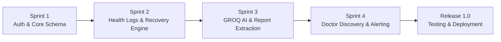
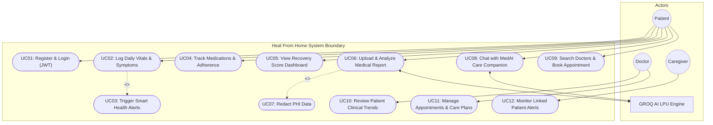
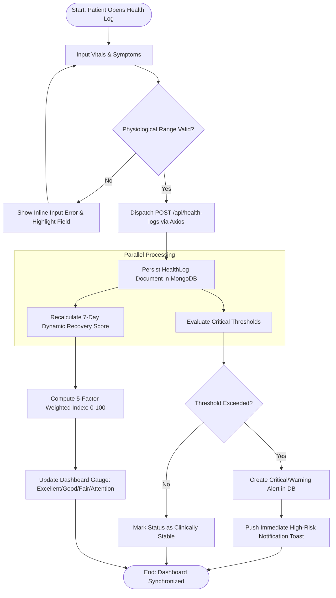
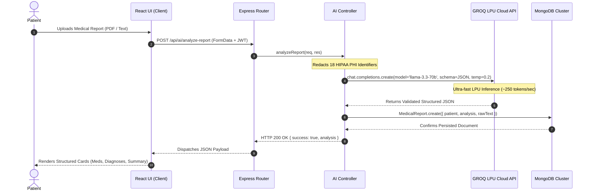
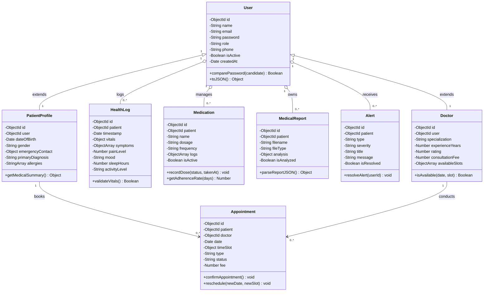
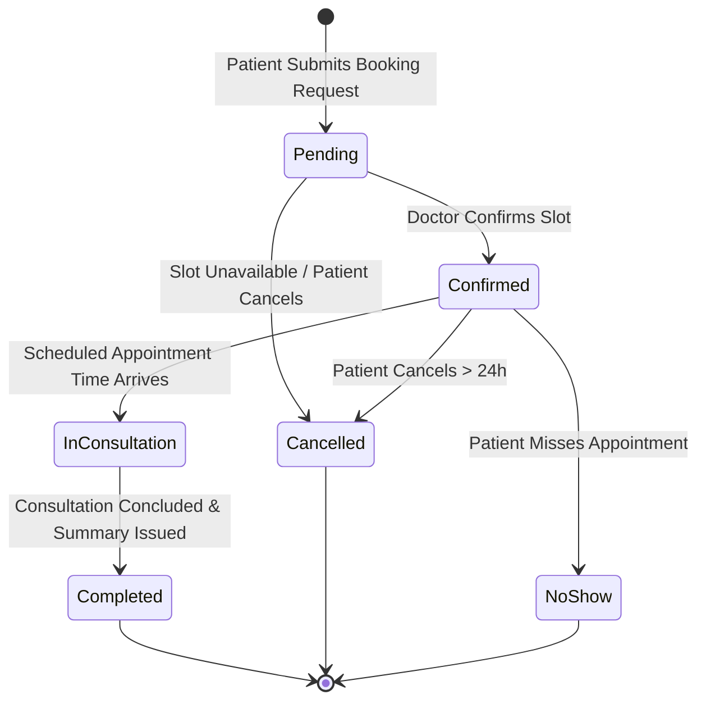
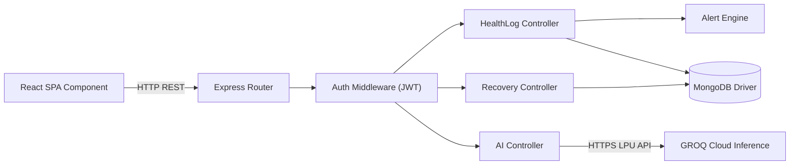

# SOFTWARE DESIGN SPECIFICATION (SDS)

## FOR
# HEAL FROM HOME: AN INTELLIGENT POST-DISCHARGE CARE COMPANION SYSTEM BASED ON OBJECT-ORIENTED TECHNOLOGY

**Release 1.0 (Production Architecture)**  
**Project-1 | Bachelor of Technology in Computer Science & Engineering**

**SUBMITTED BY:**  
- **`<Name of Student 1>`** (University Roll No: **`<University Roll No 1>`**)  
- **`<Name of Student 2>`** (University Roll No: **`<University Roll No 2>`**)  
- **`<Name of Student 3>`** (University Roll No: **`<University Roll No 3>`**)  

**Under the Guidance of:**  
**`<Name of Guide(s)>`**  
*`<Designation, Department of Computer Science & Engineering>`*

---

**Department of Computer Science & Engineering, Faculty of Engineering**  
**MEDICAPS UNIVERSITY, INDORE - 453331**  
**Academic Year: 2026 - 2027**

---

## TABLE OF CONTENTS
1. [Introduction](#1-introduction)  
   1.1 [Purpose](#11-purpose)  
   1.2 [Document Conventions](#12-document-conventions)  
   1.3 [Intended Audience and Reading Suggestions](#13-intended-audience-and-reading-suggestions)  
   1.4 [References](#14-references)  
2. [Analysis Model](#2-analysis-model)  
   2.1 [Methodology Used (Object-Oriented & Agile Process Model)](#21-methodology-used)  
   2.2 [Use Case Diagrams & Specifications](#22-use-case-diagrams--specifications)  
   2.3 [Activity Diagrams](#23-activity-diagrams)  
   2.4 [Sequence Diagrams](#24-sequence-diagrams)  
   2.5 [Class Diagram](#25-class-diagram)  
   2.6 [State Transition Diagram](#26-state-transition-diagram)  
3. [Design Model](#3-design-model)  
   3.1 [Architectural Design](#31-architectural-design)  
       3.1.1 [System Architecture Diagram](#311-system-architecture-diagram)  
       3.1.2 [Description of Architectural Design](#312-description-of-architectural-design)  
   3.2 [Database Design](#32-database-design)  
       3.2.1 [Data Dictionary](#321-data-dictionary)  
       3.2.2 [Normalization (1NF, 2NF, 3NF Analysis)](#322-normalization)  
   3.3 [Component Design](#33-component-design)  
       3.3.1 [Package Diagram](#331-package-diagram)  
       3.3.2 [Component Diagram](#332-component-diagram)  
       3.3.3 [Deployment Diagram](#333-deployment-diagram)  
   3.4 [Interface Design](#34-interface-design)  
       3.4.1 [Screen Layout Specifications](#341-screen-layout-specifications)  
4. [Appendices](#4-appendices)  
   - [Appendix C1: Glossary](#appendix-c1-glossary)  
   - [Appendix C2: To Be Determined (TBD) List](#appendix-c2-to-be-determined-tbd-list)  

---

## 1. INTRODUCTION

### 1.1 Purpose
This Software Design Specification (SDS) document provides a comprehensive, rigorous, and systematic architectural description for **"Heal From Home" (Heal-FH)**, Release 1.0. "Heal From Home" is an intelligent, full-stack post-discharge remote patient monitoring and healthcare companion platform. The purpose of this SDS is to formally translate functional, non-functional, and clinical requirements into concrete structural, behavioral, and deployment models. It covers all core subsystems:
- Role-Based Authentication and Authorization (Patient, Doctor, Caregiver, Admin)
- Continuous Vitals and Behavioral Health Logging
- Dynamic Multi-Factor Recovery Scoring (0–100 index)
- Rule-Based Clinical Complication Prediction & Smart Alerting
- Generative AI Medical Report Analysis (GROQ LLaMA-3.3-70B Engine)
- Conversational Healthcare Companion ("MedAI")
- Verified Doctor Discovery & Appointment Management

### 1.2 Document Conventions
This document adheres to the **IEEE 1016-2009 Standard** for Information Technology — Systems and Software Engineering — Software Design Descriptions, alongside the **Unified Modeling Language (UML 2.5)** standard defined by the Object Management Group (OMG). The following typographical conventions are observed throughout:
- **Bold Text**: Used for section headings, table headers, database schema entity names, and primary keywords.
- `Monospaced Font`: Used for source code references, directory paths, schema field names, API routes, and code blocks.
- *Italic Text*: Used for clinical terminology, emphasis, and medical classifications.
- **Cross-references `[X]`**: Indicated in square brackets corresponding strictly to the numbered References list.

### 1.3 Intended Audience and Reading Suggestions
This SDS is intended for software engineers, clinical informatics advisors, academic evaluators, system administrators, and quality assurance personnel. Recommended reading sequence:
- **System Architects and Technical Leads**: Focus on Section 2.1 (Methodology), Section 2.5 (Class Diagram), Section 3.1 (Architectural Design), and Section 3.3 (Component Design).
- **Full-Stack Developers**: Review Section 2.2 (Use Cases), Section 2.4 (Sequence Diagrams), and Section 3.2 (Database Design & Data Dictionary).
- **AI/ML Specialists**: Inspect Section 2.3 (AI Workflows), Section 3.1.2 (Intelligence Layer), and Section 3.2.1 (MedicalReport Data Dictionary).
- **QA Engineers & Evaluators**: Read Section 2.2 (Use Case Specifications), Section 3.4 (Interface Design), and Appendix C2 (TBD List).

### 1.4 References
- **[1]** Q. Liu et al., "A Review of Applying Large Language Models in Healthcare," *IEEE Access*, vol. 13, pp. 6878-6892, 2025.
- **[2]** M. S. Patel et al., "Using remotely monitored patient activity patterns after hospital discharge to predict 30 day hospital readmission: a randomized trial," *Scientific Reports*, vol. 13, no. 8258, pp. 1-9, 2023.
- **[3]** Y. S. Yashwanth and R. Shettar, "Zero and Few Short Learning Using Large Language Models for De-Identification of Medical Records," *IEEE Access*, vol. 12, pp. 110385-110393, 2024.
- **[4]** S. Sai et al., "Generative AI for Transformative Healthcare: A Comprehensive Study of Emerging Models, Applications, Case Studies, and Limitations," *IEEE Access*, vol. 12, pp. 31078-31106, 2024.
- **[5]** A. Vaswani et al., "Attention is all you need," *Advances in Neural Information Processing Systems (NeurIPS)*, pp. 6000-6010, 2017.
- **[6]** GROQ Cloud LPU Inference API Documentation, https://console.groq.com, 2026.

---

## 2. ANALYSIS MODEL

### 2.1 Methodology Used
The software engineering lifecycle for "Heal From Home" is implemented using an **Object-Oriented Analysis and Design (OOAD)** approach governed by the **Agile Scrum Process Model**. 



- **Object-Oriented Paradigm**: Encapsulates clinical concepts (Patients, Doctors, Vitals, Medications, Reports, Alerts) into cohesive classes with rich validation methods and state transitions.
- **Model-View-Controller (MVC) Pattern**: Separates data representations (`models/`), user presentation (`frontend/src/pages/`), and API routing logic (`controllers/`).
- **Agile Scrum Execution**: Four two-week sprints delivering incremental, testable increments validated against clinical use cases.

---

### 2.2 Use Case Diagrams & Specifications



#### Use Case Specification 1: Log Daily Vitals & Auto-Trigger Alerts
| Field | Specification Details |
|---|---|
| **Name Of Use Case** | UC02: Log Daily Vitals & Symptoms with Automatic Alert Evaluation |
| **Actor(s)** | Patient, Caregiver (Primary); Health Alert Engine (System) |
| **Pre-Condition** | User is securely authenticated via JWT with role `patient` or `caregiver`. |
| **Primary Flow of Events** | 1. Patient navigates to the "Health Logs" screen.<br>2. Patient inputs vital measurements: Blood Pressure (Systolic/Diastolic), Heart Rate, SpO2, Temperature, Pain Level (0–10), Activity Level, and Sleep Hours.<br>3. Patient clicks "Save Vitals Log".<br>4. Frontend validates inputs against physiological boundary constraints and dispatches `POST /api/health-logs`.<br>5. `healthLogController` saves the record in MongoDB and invokes the Alert Engine.<br>6. System evaluates vitals against clinical thresholds (SpO2 < 93%, HR > 130, SBP > 160, Temp > 38.5°C).<br>7. If all vitals are normal, system updates the 7-day rolling log cache and returns HTTP 201 Created.<br>8. UI confirms submission and updates real-time vital trend line charts. |
| **Alternate Flow of Events** | **Alternate Flow 1 (Critical Vital Anomaly Detected):**<br>If SpO2 < 93% or Systolic BP > 160 mmHg, `Alert.create()` generates a "critical" alert with immediate remedial advice. The response payload returns alert metadata; the UI displays an urgent warning banner and advises hospital contact.<br><br>**Alternate Flow 2 (Validation Failure):**<br>If input is out of human physiological range (e.g. Heart Rate = 300 bpm), system rejects the request with HTTP 400 Bad Request and highlights the invalid input field. |
| **Post-Condition** | HealthLog document is persisted in MongoDB; dynamic recovery score is invalidated and recalculated; alerts are active if thresholds were breached. |
| **Use Case Termination** | Success confirmation toast displayed, and dashboard metrics refresh. |

#### Use Case Specification 2: Medical Report AI Analysis & Entity Extraction
| Field | Specification Details |
|---|---|
| **Name Of Use Case** | UC06: Upload & Analyze Medical Discharge Report using Generative AI |
| **Actor(s)** | Patient (Primary); GROQ AI LLaMA-3.3-70B API (Secondary Service) |
| **Pre-Condition** | Patient has access to an electronic medical report, clinical text, or discharge summary. |
| **Primary Flow of Events** | 1. Patient accesses the "Report Analyzer" module.<br>2. Patient uploads a PDF/image report or pastes clinical discharge text.<br>3. Frontend sends `multipart/form-data` to `POST /api/ai/analyze-report`.<br>4. Backend sanitizes text by stripping 18 HIPAA PHI identifiers (names, dates, contact numbers).<br>5. Controller formats a constrained prompt specifying the exact JSON schema and calls GROQ API.<br>6. GROQ LLaMA-3.3-70B executes inference (temperature = 0.2) and returns structured JSON.<br>7. Backend parses JSON (medications, diagnoses, abnormal labs, physical restrictions, summary).<br>8. Backend persists report in `MedicalReport` collection and returns parsed JSON to client.<br>9. UI renders interactive cards for medications, warnings, and simplified patient summary. |
| **Alternate Flow of Events** | **Alternate Flow 1 (GROQ API Timeout or Rate Limit):**<br>If the external AI gateway fails, backend catches error, flags report as "pending analysis", logs raw text, and returns a graceful HTTP 503 error instructing user to retry.<br><br>**Alternate Flow 2 (Malformed JSON Output):**<br>If AI response contains formatting anomalies, regex JSON extractor isolates the valid JSON block; if unrecoverable, raw summary text is stored as a fallback. |
| **Post-Condition** | MedicalReport document is stored; patient gains instant plain-language comprehension of instructions. |
| **Use Case Termination** | Structured report cards successfully rendered in UI. |

---

### 2.3 Activity Diagrams



---

### 2.4 Sequence Diagrams



---

### 2.5 Class Diagram



---

### 2.6 State Transition Diagram



---

## 3. DESIGN MODEL

### 3.1 Architectural Design

#### 3.1.1 System Architecture Diagram

```mermaid
flowchart TD
    subgraph Tier1["Tier 1: Presentation Layer (React 18 SPA)"]
        UI1["Glassmorphic Dashboard & Recovery Gauge"]
        UI2["Chart.js Longitudinal Vitals Trends"]
        UI3["MedAI Conversational Chat Console"]
        UI4["Report Analyzer & Upload Interface"]
    end

    subgraph Tier2["Tier 2: Application & API Layer (Node.js / Express)"]
        GW["REST API Gateway & Route Handlers"]
        MW["Security Middleware (JWT, Helmet, CORS, Rate-Limit)"]
        CTL1["Auth & User Controller"]
        CTL2["HealthLog & Alert Dispatch Controller"]
        CTL3["Recovery Score Engine (7-Day Rolling)"]
        CTL4["Doctor & Appointment Controller"]
    end

    subgraph Tier3["Tier 3: Intelligence Layer (AI & ML)"]
        GROQ["GROQ Cloud High-Speed LPU Engine"]
        LLM["LLaMA-3.3-70B Open-Weights Model"]
        RULES["Clinical Rule-Based Complication Engine"]
        DEID["HIPAA PHI Sanitizer"]
    end

    subgraph Tier4["Tier 4: Persistence Layer (MongoDB Cluster)"]
        DB1[("users & profiles")]
        DB2[("healthlogs & vitals")]
        DB3[("medications & logs")]
        DB4[("medicalreports & alerts")]
        DB5[("doctors & appointments")]
    end

    Tier1 <==>|HTTPS / JSON via Axios| Tier2
    Tier2 <==>|Internal SDK Call| Tier3
    Tier2 <==>|Mongoose ODM (Port 27017)| Tier4
```

#### 3.1.2 Description of Architectural Design
- **Presentation Layer (Frontend)**: Implemented as a Single Page Application (SPA) using React 18, React Router v6, and Framer Motion. Delivers a zero-latency user experience with responsive glassmorphism, real-time vital sign charts powered by Chart.js, and multi-theme adaptability (light/dark mode).
- **Application Layer (Backend)**: Built with Node.js and Express.js REST architecture. Features token-based JWT authentication, route-level authorization middleware, and rate-limiting. Orchestrates health log ingestion, recovery score calculation, and appointment lifecycles.
- **Intelligence Layer (AI/ML Engine)**: Integrates the GROQ Cloud LPU SDK running LLaMA-3.3-70B. Capable of sub-second inference speeds (~250 tokens/sec), executing structured JSON entity extraction from clinical text and 24/7 conversational assistance through "MedAI". Complemented by a deterministic clinical threshold engine for instant anomaly detection.
- **Persistence Layer (Database)**: Powered by MongoDB with Mongoose ODM. Schemas enforce compound indices (`{ patient: 1, timestamp: -1 }`) for fast time-series retrieval of vital trends and recovery data.

---

### 3.2 Database Design

#### 3.2.1 Data Dictionary

##### Entity 1: Users Collection (`User.js`)
| Field Name | Data Type | Constraints / Key | Description & Business Rules |
|---|---|---|---|
| `_id` | ObjectId | Primary Key, Auto | Unique internal MongoDB identifier for the user account. |
| `name` | String | Required, Trim | Full legal name of the user. |
| `email` | String | Required, Unique, Lowercase | User electronic mail address used for authentication. |
| `password` | String | Required, Min 6, Select=False | Hashed password using bcryptjs with 12 salt rounds. |
| `role` | String | Enum: `patient`, `doctor`, `caregiver`, `admin` | Role-based access tier; defaults to `patient`. |
| `phone` | String | Optional, Trim | Emergency contact telephone number. |
| `isActive` | Boolean | Default: True | Indicates whether account is actively authorized. |
| `lastLogin` | Date | Optional | Timestamp of the most recent authentication session. |
| `createdAt` | Date | Default: Date.now | System generation timestamp of user entity. |

##### Entity 2: HealthLogs Collection (`HealthLog.js`)
| Field Name | Data Type | Constraints / Key | Description & Business Rules |
|---|---|---|---|
| `_id` | ObjectId | Primary Key, Auto | Unique identifier for the health log instance. |
| `patient` | ObjectId | Foreign Key -> User, Req | Identifies the recovering patient submitting the log. |
| `timestamp` | Date | Default: Date.now, Indexed | Timestamp of vital measurement recording. |
| `vitals.heartRate` | Number | Range: 30 - 250 bpm | Resting pulse rate; normal baseline 60–100 bpm. |
| `vitals.bloodPressureSystolic` | Number | Range: 60 - 250 mmHg | Systolic arterial pressure; alert triggered if > 160. |
| `vitals.bloodPressureDiastolic`| Number | Range: 40 - 150 mmHg | Diastolic arterial pressure; normal < 80 mmHg. |
| `vitals.temperature` | Number | Range: 34.0 - 42.0 C | Body temperature in Celsius; alert if > 38.5 C. |
| `vitals.oxygenSaturation` | Number | Range: 70 - 100 % | Blood oxygen saturation (SpO2); critical if < 93%. |
| `painLevel` | Number | Range: 0 - 10, Default: 0 | Self-reported visual analogue pain severity scale. |
| `sleepHours` | Number | Range: 0 - 24 hours | Total sleep duration during preceding 24-hour cycle. |
| `activityLevel` | String | Enum: bedrest, active... | Subjective ambulation tier used in recovery index. |

##### Entity 3: MedicalReports Collection (`MedicalReport.js`)
| Field Name | Data Type | Constraints / Key | Description & Business Rules |
|---|---|---|---|
| `_id` | ObjectId | Primary Key, Auto | Unique identifier of the clinical medical report. |
| `patient` | ObjectId | Foreign Key -> User, Req | Associated patient account. |
| `filename` | String | Required | Internal filesystem storage name. |
| `fileType` | String | Enum: pdf, image, other | MIME format classification of uploaded artifact. |
| `analysis.medications` | Array of Objects | Schema Array | Extracted drug name, dosage, frequency, instructions. |
| `analysis.diagnoses` | Array of Strings | Schema Array | Clinical disease diagnoses identified by AI. |
| `analysis.summary` | String | Text | Plain-language patient-friendly explanation generated by GROQ. |
| `isAnalyzed` | Boolean | Default: False | Flag indicating whether LLM extraction completed. |

##### Entity 4: Alerts Collection (`Alert.js`)
| Field Name | Data Type | Constraints / Key | Description & Business Rules |
|---|---|---|---|
| `_id` | ObjectId | Primary Key, Auto | Unique alert identifier. |
| `patient` | ObjectId | Foreign Key -> User, Req | Patient who experienced the vital anomaly. |
| `type` | String | Enum: vital, complication.. | Category of health alert. |
| `severity` | String | Enum: low, medium, high, critical | Clinical criticality rating. |
| `title` | String | Required | Concise title of clinical warning. |
| `message` | String | Required | Actionable remediation instructions. |
| `isResolved` | Boolean | Default: False | Resolution status flag acknowledged by doctor/patient. |

#### 3.2.2 Normalization
1. **First Normal Form (1NF)**: Every field contains atomic, scalar values. Subdocument arrays (`symptoms`, `logs`, `medications`) are uniquely indexed and contain structured objects rather than concatenated comma-separated strings.
2. **Second Normal Form (2NF)**: All attributes are fully functionally dependent on the entity's primary key (`_id`). General user authentication attributes are isolated in `Users`, while clinical metrics reside in `HealthLogs` and `PatientProfiles`.
3. **Third Normal Form (3NF)**: Transitive dependencies are removed. Doctor specialties, ratings, and fees reside strictly in `Doctors`; `Appointments` reference doctor and patient `ObjectIds` rather than duplicating demographic information.

---

### 3.3 Component Design

#### 3.3.1 Package Diagram

```mermaid
flowchart TD
    subgraph Root["heal-from-home Root Package"]
        subgraph ClientPkg["frontend (Client Package)"]
            P1["pages/ (Dashboard, Vitals, Chat, Reports, Doctors)"]
            P2["components/ (Sidebar, TopBar, AppLayout)"]
            P3["context/ (AuthContext, ThemeContext)"]
            P4["utils/ (api Axios Instance)"]
        end

        subgraph ServerPkg["backend (Server Package)"]
            S1["routes/ (auth, healthLog, recovery, ai, doctor)"]
            S2["middleware/ (auth JWT Verification)"]
            S3["controllers/ (ai, healthLog, recovery, appointment)"]
            S4["models/ (User, HealthLog, Medication, Alert, Report)"]
        end
    end

    ClientPkg <==>|REST Endpoints (JSON)| ServerPkg
```

#### 3.3.2 Component Diagram



#### 3.3.3 Deployment Diagram

```mermaid
flowchart TB
    subgraph ClientNode["Client Device (PC / Smartphone)"]
        Browser["Modern Web Browser<br/>(React 18 SPA Artifact)"]
    end

    subgraph AppServerNode["Application Server Node (Cloud VM / Container)"]
        NodeServer["Node.js LTS Runtime<br/>(Express.js REST Engine : Port 5000)"]
    end

    subgraph CloudDB["Database Cluster (MongoDB Atlas)"]
        MongoCluster[("healfromhome_db<br/>(Port 27017, TLS 1.3)")]
    end

    subgraph AICloud["External AI Cluster (GROQ Cloud)"]
        LPU["GROQ Inference Engine<br/>(LLaMA-3.3-70B LPU Nodes)"]
    end

    Browser <==>|HTTPS / TLS 1.3 (Port 443)| NodeServer
    NodeServer <==>|Mongoose TCP / SSL| MongoCluster
    NodeServer <==>|Secure HTTPS REST API| LPU
```

---

### 3.4 Interface Design

#### 3.4.1 Screen Layout Specifications
1. **Dynamic Recovery Dashboard**:
   - Central radial gauge displaying the real-time Recovery Score (0–100) color-coded:
     - **Green** ($\ge 80$): Excellent
     - **Blue** (60–79): Good
     - **Amber** (40–59): Fair
     - **Red** ($< 40$): Needs Attention
   - Sub-score breakdown cards for Vitals (30), Symptoms (20), Activity (20), Sleep (15), and Medication Adherence (15).
   - Real-time notification badge displaying active high-risk alerts.
2. **Health Logging & Trends**:
   - Card-based numerical inputs with bounds-checking for systolic BP, diastolic BP, heart rate, $\text{SpO}_2$, temperature, and blood glucose.
   - Interactive pain rating slider (0–10) with visual emoji feedback.
   - Interactive 7-day multi-line chart rendering physiological trends with normal reference threshold bands.
3. **MedAI Conversational Assistant**:
   - Floating chat interface with conversational history memory (last 10 turns).
   - Fast token streaming with automated disclaimers recommending immediate medical consultation for emergency symptoms.
4. **Medical Report Analyzer**:
   - Drag-and-drop file upload zone supporting PDF and clinical image formats.
   - Categorized card views for extracted medications, detected diagnoses, abnormal lab values with normal ranges, and simplified summary.
5. **Doctor Discovery & Tele-Consultation**:
   - Filterable physician cards displaying photo avatar, specialization badge, experience, patient rating, and consultation fee.
   - Modal date/time slot picker for direct appointment scheduling.

---

## 4. APPENDICES

### Appendix C1: Glossary
| Term / Acronym | Formal Definition |
|---|---|
| **AI (Artificial Intelligence)** | The simulation of human intelligence processes by computer algorithms and machine learning models. |
| **AUC-ROC** | Area Under the Receiver Operating Characteristic curve; metric evaluating classification discrimination. |
| **BPM** | Beats Per Minute; clinical measurement unit for heart rate. |
| **CORS** | Cross-Origin Resource Sharing; security protocol controlling web requests between different domain origins. |
| **DFD / CFD** | Data Flow Diagram / Control Flow Diagram; diagrammatic models of data and control information flow. |
| **EHR** | Electronic Health Record; systematized digital collection of patient health information. |
| **GROQ LPU** | Language Processing Unit developed by Groq designed specifically for ultra-low latency LLM inference. |
| **HIPAA** | Health Insurance Portability and Accountability Act of 1996; governs the confidentiality of health information. |
| **JWT** | JSON Web Token; compact, URL-safe standard for cryptographically signed authentication tokens. |
| **LLM** | Large Language Model; transformer-based neural network trained on vast text corpora for language generation. |
| **MERN Stack** | Full-stack software architecture comprising MongoDB, Express.js, React, and Node.js. |
| **ODM** | Object Data Modeling; abstraction library (e.g. Mongoose) mapping JavaScript objects to database documents. |
| **PHI** | Protected Health Information; 18 personal identifiers defined under HIPAA regulations. |
| **RBAC** | Role-Based Access Control; security model granting system permissions based on assigned user roles. |
| **RPM** | Remote Patient Monitoring; technology enabling continuous digital collection of patient health data at home. |
| **SpO2** | Peripheral Capillary Oxygen Saturation; percentage of oxygen-saturated hemoglobin relative to total hemoglobin. |

### Appendix C2: To Be Determined (TBD) List
| Item No. | TBD Topic | Current Working Assumption | Target Milestone |
|---|---|---|---|
| **TBD-01** | Direct Bluetooth IoT Vitals Sync | Vitals currently logged via validated user forms; Web-Bluetooth API integration planned for automatic pulse oximeter pairing. | Release 2.0 (Phase 2) |
| **TBD-02** | Automated SMS / WhatsApp Gateway | Notifications currently surfaced via in-app toast and dashboard alerts; Twilio SMS gateway planned for emergency contacts. | Sprint 5 Testing |
| **TBD-03** | Multi-Language Audio Transcription | Medical reports accepted in text/PDF; multi-lingual voice dictation via Whisper planned for regional languages. | Release 2.1 |
